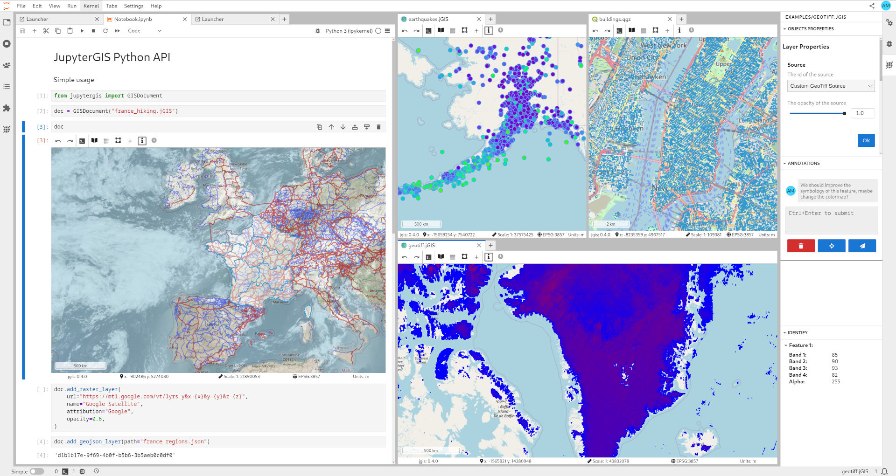
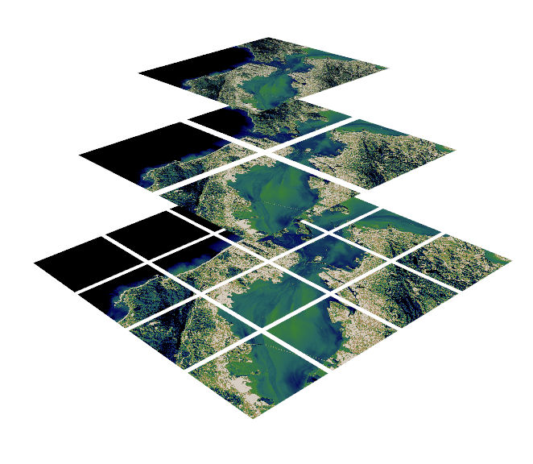
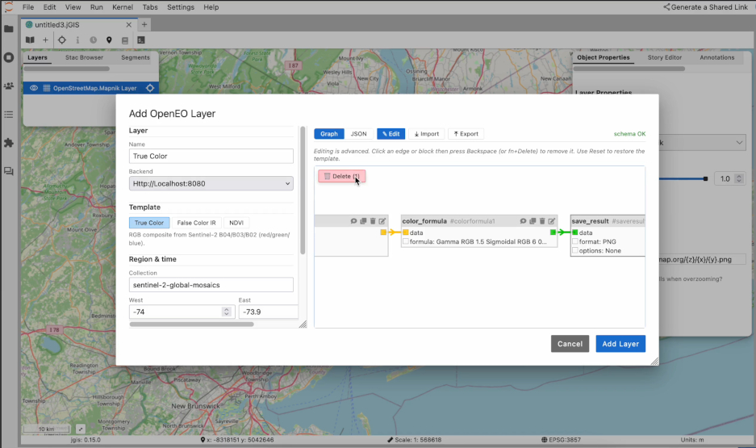

## :wave: Hi, I'm Martin! Github: [`martinRenou`]([guillaumeeb](https://github.com/martinRenou)) {.smaller .even-smaller-header}

::::::::::::columns
:::::::::{.column width=50%}
::::::evenly-spaced
:computer: Technical Director [@QuantStack](https://quantstack.net)

:open_hands: Open source maintainer & contributor:
[jupytergis](https://github.com/geojupyter/jupytergis),
[jupyter-widgets](https://github.com/jupyter-widgets),
[jupyterlite](https://github.com/jupyterlite),
[jupytercad](https://github.com/jupytercad),
several [conda-forge](https://conda-forge.org/) packages
and more!

Currently working on [Notebook.link](https://github.com/notebook-link)

::::::
:::::::::

::::::{.column width=50%}
](/assets/images/qr.svg){width=100%}
::::::
:::::::::

:::notes
QR code: These slides! There will be links you may want to follow and bonus slides you
may want to see on your own time.

Emojis: Open source, documentation, optimizing for cognitive load, plants and nature,
musical instruments, dogs!
:::

## :wave: Hi, I'm Guillaume! GitHub: [guillaumeeb](https://github.com/guillaumeeb) {.smaller .even-smaller-header}

:::::::::columns
::::::{.column width=50%}
:::evenly-spaced
:computer: :space_invader: Satellite image processing and distributed data analysis expert at [CNES](https://cnes.fr/en)

:snowflake: :floppy_disk: Maintaining snow detection algorithm ([Let it snow](https://gitlab.orfeo-toolbox.org/remote_modules/let-it-snow)), and improving CNES [library ecosystem](https://geodes-tools.cnes.fr/en/) (from the outside mainly)

:earth_asia: Member of [Pangeo community](https://pangeo.io/) for 8 years (missed the start)

:factory: Previously head of the CNES computing center team, specialized in Big Data tools (Spark, Dask)

:open_hands: Open source supporter, funding and small contributor:
[dask](https://github.com/dask/dask),
[dask-jobqueue](https://github.com/dask/dask-jobqueue),
[Let it snow](https://gitlab.orfeo-toolbox.org/remote_modules/let-it-snow),

:open_hands: :satellite: :brain: :earth_asia:
:tent: :runner: :snowboarder: :guitar: :wine_glass: :bridge_at_night:
:::
::::::

::::::{.column width=50%}
](/assets/images/qr.svg){width=100%}
::::::
:::::::::

:::notes
Emojis: Open source, Satellite, optimizing for cognitive load, earth observation,
hiking, running, mountain snow climbing, guitar, party!
:::

# :earth_asia: GeoJupyter community overview

:::{style="font-size: 1.8em"}
:zap: Lightning version!
:::

:link: [geojupyter.org](https://geojupyter.org/)

:::notes
I'm gonna keep this really high level, but feel free to ask me questions or see bonus
slides at the end on your own time :)
:::

# JupyterGIS

## JupyterGIS

  

    Started from an
    <a href="https://www.esa.int">European Space Agency (ESA)</a>
    fund: “Real-time collaboration and collaborative editing for GIS workflows with Jupyter and QGIS.”
  

  

  

    Multiple fundings from
    <a href="https://cnes.fr/en">Centre National d'Études Spatiales (CNES)</a>
  

  

  Development led by <a href="https://quantstack.net">QuantStack</a>, in collaboration with:

<ul>
  <li><a href="https://dse.berkeley.edu">Schmidt DSE @ UC Berkeley</a></li>
  <li><a href="https://www.simula.no">Simula Research Lab</a></li>
  <li><a href="https://developmentseed.org">developmentSEED</a></li>
</ul>

## JupyterGIS highlights

- Integrated in <b>Jupyter</b> (JupyterLab, Jupyter Notebook, JupyterLite...)
- <b>Collaborative GIS</b> with jupyter-collaboration
- Support for <b>QGIS</b> files opening with the associated server-extension
- Storymaps (scrollytelling)
- Collaborative labeling
- Exploring <b>OpenEO</b> graphs
- STAC search
- and many more...

## JupyterGIS demo

Enough talking! 🫢

## Jupyter Tiler

A building block (on top of [TiTiler](https://github.com/developmentseed/titiler/) and
[xpublish-tiles](https://github.com/earth-mover/xpublish-tiles)) for interactively
exploring Xarray data.

:tada: [Available to try now in JupyterGIS](https://jupytergis.readthedocs.io/en/latest/user_guide/python_api/api.html#jupytergis.GISDocument.add_data_array_layer)!

:::notes
Mention Development Seed and Earthmover
:::

## Jupyter Tiler

:::notes
Here, we're directly rendering from an Xarray dataset based on the requested spatial
extent.

This means we can use lazy computation to compute subsets of the dataset to generate
tiles.
We'll show more about this in the demo.
:::

## Jupyter Tiler

::::::evenly-spaced
Google Earth Engine UX with open source tools?

:::fragment
### :tada: Demo time

<!-- ## :rotating_light: Emergency video, ignore me

 -->

:::
::::::

:::notes
Many researchers use GEE because of its strong and _accessible_ visualization-analysis feedback loop.

GEE is expensive and subjects users to vendor lock-in.

We haven't quite nailed this in the open source ecosystem yet.

**The cloud-native pieces are there, but the user experience isn't there yet**.

...

GEE achieves this through efficient use of overviews -- depending on the requested
output scale, the appropriate resolution of input data is used.

In other words, if the map is zoomed all the way out, computation is performed on the
lowest resolution overview.
:::

## Jupyter Tiler - current limitations

### Overviews

Secret sauce of GEE experience is [using **overviews** efficiently](https://developers.google.com/earth-engine/guides/scale)

::: footer
Image source: <https://www.kitware.com/deciphering-cloud-optimized-geotiffs/>
:::

:::notes
Let's talk about overviews.

Cloud optimization can mean lots of stuff, and one of those stuff is overviews, or
tile pyramids.

* Lower resolution chunks that can be accessed directly
* Critical for cloud-optimizing our data for visualization!
  When you're zoomed out, it's wasteful to read every pixel on your dataset, because
  your screen probably has far fewer pixels than the full resolution data.
* Zarrs, Cloud Optimized GeoTIFFs are notable formats that support overviews
:::

## Jupyter Tiler - current limitations {.smaller}

### Overviews

:::evenly-spaced
**Problem**: A _computation_ on an Xarray dataset is still performed at full resolution.

For a tight viz-analysis feedback loop, we might want to compute on overviews.
:::

## JupyterGIS with OpenEO (WIP)

Another approach: server-side execution!

:::notes
The approach we just discussed is client-side.

We're also working on an approach using OpenEO to submit tasks (as graphs) to an OpenEO
backend, ideally positioned close to the data.

Guillaume to add more?
:::

## How you can participate in GeoJupyter



# :heart: Thank you! :heart:

# :tada: Bonus slides

## GeoJupyter community overview {.smaller}

### Our values

:::evenly-spaced
:open_hands: **Open source & open science** - geospatial data is important to everyone!

:cartwheeling: **Approachability** and **playfulness**, like desktop GIS tools

:feather: **Flexibility** and **reproducibility**, like coding methods

:performing_arts: **Collaboration** and **storytelling**, like Jupyter Notebooks
:::

## GeoJupyter community overview {.smaller}

### Geospatial data practice for the modern era

**Geospatial data is everywhere and matters for everyone! 🚚🚢🗺️🧪🌏**

:::evenly-spaced
:handshake: Real-time collaboration (like Google Docs)

:recycle: Reproducibility (by default!)

:leaves: Accessibility (transition to new ways of working, including reproducibility)

:cloud: **Cloud-native** (computing, data formats)

:robot: AI :scream: :boom: (risks & opportunities)

 
 
:::

## GeoJupyter community overview {.smaller}

### Partners :scientist: :teacher: :technologist:

* QuantStack - Open source for science
* Maryam Hosseini - urban systems, computer vision, & open source
* Clancy Wilmott - Critical Cartography, Geovisualisation and Design
* Qiusheng Wu - Geospatial, AI, & education
* Sarah Chasins & Parker Zeigler - cartography, CS, & open source
* Nancy Thomas & Iryna Dronova - Berkeley Geospatial Innovation Facility
* Carl Boettiger - Geospatial, AI, & education
* Benny Szeghy & Esha Potharaju - GeoJupyter interns
* Friends & neighbors: BIDS, MyST, JupyterHub, earthaccess, DevSeed, Pangeo, 2i2c, Clark
  University, Stanford, Simula, CNES, ESA
* **MANY MORE!!!**

## [Potential future initiatives](https://github.com/geojupyter/initiatives/issues?q=sort%3Aupdated-desc%20is%3Aissue%20is%3Aopen%20label%3A%22type%3A%20initiative%22)?

:::evenly-spaced
:open_book: "Scrollytelling" with a Markdown authoring workflow?
([initiative](https://github.com/geojupyter/initiatives/issues/19))

:robot: GeoAI? :thinking:
([initiative](https://github.com/geojupyter/initiatives/issues/14), [prototype](https://github.com/geojupyter/jupyter-geoagent),
[talk](https://www.youtube.com/watch?v=_5yuXU5salY))

:rock: Richer geospatial primitives for Python?
([initiative](https://github.com/geojupyter/initiatives/issues/18))

:mountain: Reproducible GUI "geoprocessing" (following lessons learned from interns' exploration)? ([initiative](https://github.com/geojupyter/initiatives/issues/3))

:art: Reusable symbology editor component?
([initiative](https://github.com/geojupyter/initiatives/issues/8))

:teacher: Example datasets for education?
([initiative](https://github.com/geojupyter/initiatives/issues/9))
:::
